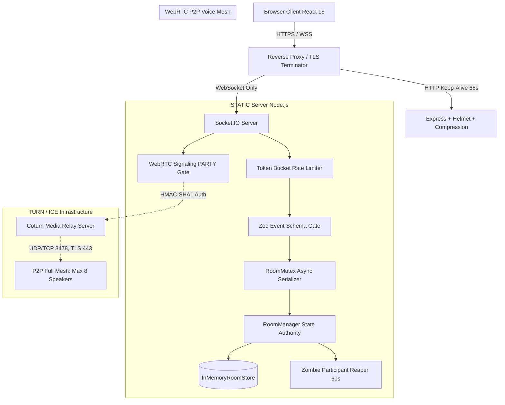
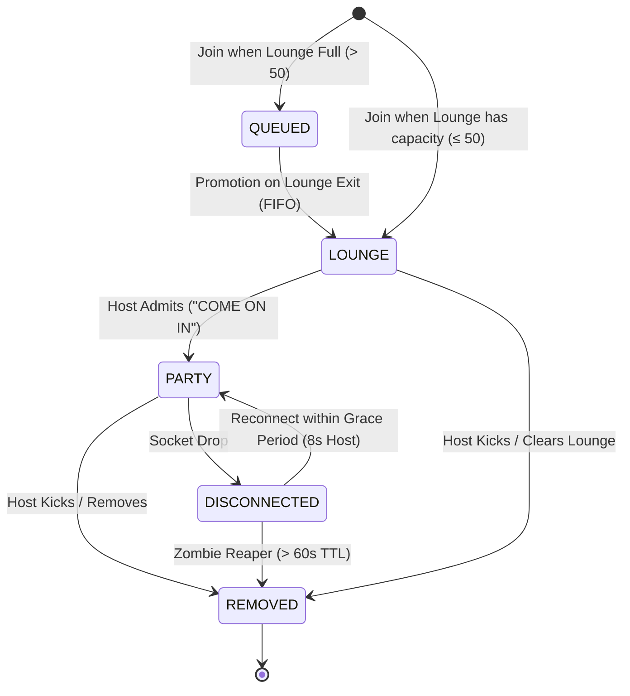

# STATIC — System Architecture (v1.4.0)

## 1. System Overview

STATIC is an ephemeral, privacy-first, full-mesh WebRTC voice party application. The system requires zero registration, uses 6-character alphanumeric room codes, and maintains in-memory ephemeral room state with no persistent storage.

---

## 2. Participant State Machine & Mesh Architecture

Participants transition through strict state gates. Audio is exchanged **strictly and exclusively** between participants in the `PARTY` state.

- **PARTY (Max 8)**: Full-mesh bidirectional WebRTC voice peers.
- **LOUNGE (Max 50)**: Silent waiting room. No media is sent to or received from lounge members.
- **QUEUED (Max 200)**: FIFO overflow queue.
- **DISCONNECTED**: Connection interrupted; temporary placeholder during network reconnection.

---

## 3. Audio & Voice Pipeline (Discord-Grade DSP)

```mermaid
flowchart LR
    Mic[Microphone 48kHz Mono] --> AudioWorklet[AudioWorklet RNNoise]
    AudioWorklet --> VAD[RMS / Spectral Envelope VAD]
    VAD --> SDP[SDP Opus Munger: minptime=10, FEC, DTX]
    SDP --> Sender[RTCRtpSender: Opus RED Priority]
    Sender --> Network((Internet))
    Network --> Receiver[RTCRtpReceiver]
    Receiver --> JitterBuffer[Adaptive Jitter Buffer 20-60ms]
    JitterBuffer --> DynamicsCompressor[Dynamics Compressor Node]
    DynamicsCompressor --> MasterGain[Master Gain]
    MasterGain --> Speakers[Audio Destination / Speakers]
```

### Voice Parameters
- **SDP Settings**: `minptime=10;useinbandfec=1;usedtx=1;stereo=0;sprop-stereo=0;maxaveragebitrate=48000;maxplaybackrate=48000;cbr=0;a=ptime:20`.
- **Target Bitrates**:
  - `GOOD`: 52 kbps (target 48–64k)
  - `FAIR`: 40 kbps
  - `POOR`: 28 kbps (FEC & DTX guaranteed)
  - `CRITICAL`: 24 kbps
- **Bandwidth Consumption**: In an 8-person room (7 peer connections), total upload is restricted to ~350 kbps average, scaling down to ~168 kbps under poor conditions.

---

## 4. Backend Hardening & Security Architecture

1. **Input Validation**:
   Every Socket.IO event payload is validated using Zod schemas (`server/src/schemas.ts`). Malformed payloads or signals exceeding safe limits (e.g., SDP > 32 KB, candidate > 2 KB) are rejected with a structured error without throwing.

2. **Rate Limiting & Anti-Brute Force**:
   - Token bucket algorithm per action (`server/src/rateLimiter.ts`).
   - Exponential lockout for repeated invalid room codes prevents enumerating the 6-character room code space.
   - Max rooms per IP (`MAX_ROOMS_PER_IP`) and global capacity cap (`MAX_ROOMS_GLOBAL`).

3. **Session Security & Superseding**:
   - Session tokens generated with `crypto.randomBytes(24)` (48 hex chars).
   - Server stores **only** SHA-256 hashes in memory, comparing candidate tokens using `crypto.timingSafeEqual`.
   - On reconnect, tokens rotate automatically and any stale socket for that session receives a `session-replaced` notification and is disconnected.

4. **Atomic Concurrency**:
   - Each room contains an asynchronous `RoomMutex` (`server/src/roomManager.ts`).
   - All mutations (joins, admits, kicks, reorders, host transfers, grace cancellations) are queued sequentially per room, eliminating race conditions.

---

## 5. Coturn TURN Relay Architecture

Coturn handles firewall and symmetric NAT traversal using time-limited HMAC-SHA1 tokens conforming to Coturn's `use-auth-secret` mechanism:

$$\text{username} = \langle\text{expiryUnix}\rangle : \langle\text{participantId}\rangle$$
$$\text{credential} = \text{Base64}\left(\text{HMAC-SHA1}(\text{secret}, \text{username})\right)$$

### Provided Relay Endpoints
- `STUN`: port 3478 / 19302
- `TURN UDP`: port 3478
- `TURN TCP`: port 3478
- `TURNS TLS`: port 443 (strict enterprise / DPI firewall traversal)

---

## 6. Observability & Operational Probes

- **Liveness**: `GET /health` (returns uptime and service status)
- **Readiness**: `GET /ready` (returns active rooms and system load)
- **Prometheus Metrics**: `GET /metrics` (`prom-client` registry):
  - `static_active_rooms` (Gauge)
  - `static_participants_total{state}` (Gauge)
  - `static_queue_length_total` (Gauge)
  - `static_signaling_messages_total{type}` (Counter)
  - `static_signaling_rejected_total{reason}` (Counter)
  - `static_rate_limit_hits_total{action}` (Counter)
  - `static_reconnects_total{status}` (Counter)
  - `static_grace_period_saves_total` (Counter)
  - `static_ice_config_requests_total` (Counter)
